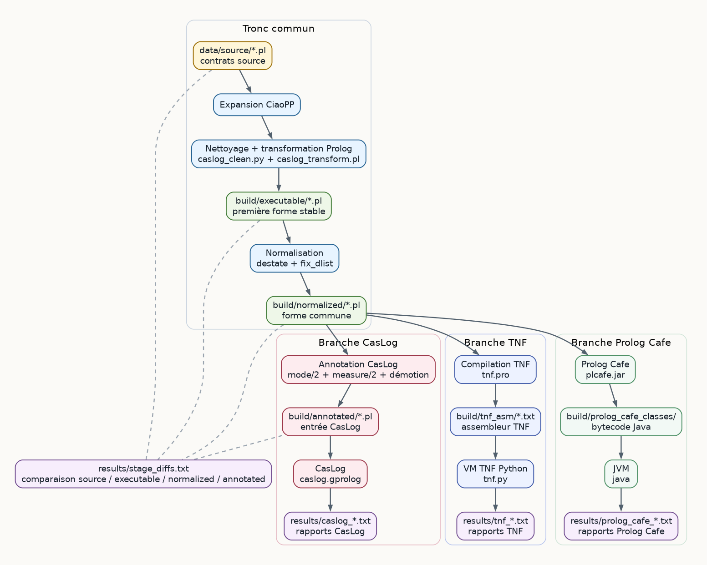

# Architecture

## Rôle du dossier

`ciaoimp_pipeline` est une version portable du pipeline CiaoImp pour les
contrats CiaoMoka/Prolog. Le dossier peut être déplacé sur une machine cible à
condition de conserver sa structure interne.

Le pipeline transforme un contrat source en trois familles de résultats :

- une entrée annotée pour l'analyse statique CasLog ;
- un assembleur TNF exécuté par la VM Python embarquée ;
- une traduction Java exécutée par Prolog Cafe.

La logique active du pipeline se trouve principalement dans `pipeline.py` et
dans `src/`. Les dossiers `tools/caslog/` et `tools/LogicTransformers/`
fournissent les moteurs externes nécessaires, mais ne constituent pas la
documentation principale du pipeline.

## Flux global



```text
data/source/*.pl
  -> expansion CiaoPP
  -> nettoyage et transformation Prolog
  -> build/executable/*.pl
  -> normalisation (destate + fix_dlist)
  -> build/normalized/*.pl
     -> annotation CasLog
     -> build/annotated/*.pl
     -> exécution CasLog
     -> results/caslog_*.txt
     -> compilation TNF
     -> build/tnf_asm/*.txt
     -> exécution VM TNF
     -> results/tnf_*.txt
     -> traduction Prolog Cafe
     -> build/prolog_cafe_src/ & build/prolog_cafe_classes/
     -> exécution Java
     -> results/prolog_cafe_*.txt

results/stage_diffs.txt compare les étapes publiques générées.
```

`build/normalized/` est la forme commune avant bifurcation. TNF et Prolog Cafe
la consomment directement, tandis que CasLog consomme la version annotée
dérivée dans `build/annotated/`.

## Chaîne d'exécution

Le runner applique la séquence suivante :

1. Résoudre le contrat source depuis `data/source/` ou depuis le chemin passé en
   argument.
2. Lancer CiaoPP pour produire une version expansée.
3. Convertir cette sortie en Prolog exploitable.
4. Pré-nettoyer le texte avec `src/transforms/caslog_clean.py`.
5. Appliquer `src/transforms/caslog_transform.pl`.
6. Écrire `build/executable/<nom>.pl`.
7. Normaliser avec `destate` puis `fix_dlist`.
8. Écrire `build/normalized/<nom>.pl`.
9. Annoter pour CasLog et écrire `build/annotated/<nom>.pl`.
10. Ajuster les modes si CasLog signale des problèmes d'annotation.
11. Exécuter CasLog sur les contrats annotés.
12. Compiler `build/normalized/<nom>.pl` en ASM TNF.
13. Exécuter l'ASM dans la VM TNF Python.
14. Compiler `build/normalized/<nom>.pl` en classes Java via Prolog Cafe.
15. Exécuter les classes générées sur la JVM.
16. Extraire les rapports finaux dans `results/`.

## Entrées et sorties

`data/source/`
: contrats source traités par le pipeline. Les fichiers `.itf` associés
complètent les contrats pour Ciao/CiaoPP.

`build/executable/`
: première sortie Prolog stable après expansion, nettoyage et transformation.

`build/normalized/`
: forme normalisée commune avant bifurcation. C'est l'entrée directe de TNF.

`build/annotated/`
: version dérivée de `build/normalized/`, enrichie avec `mode/2` et `measure/2`
pour CasLog.

`build/tnf_asm/`
: assembleur TNF produit depuis `build/normalized/`.

`build/prolog_cafe_src/` et `build/prolog_cafe_classes/`
: code source et bytecode Java générés par Prolog Cafe depuis `build/normalized/`.

`results/`
: rapports consolidés CasLog, TNF, Prolog Cafe, et diff entre étapes publiques.

`site/`
: documentation HTML générée depuis `docs/` et `mkdocs.yml`.

Les dossiers `site/`, `build/` et `results/` contiennent des artefacts générés.
La source de vérité reste `src/` pour la logique du pipeline et `docs/` pour la
documentation.

## Architecture du projet

Cette vue montre les dossiers à connaître pour utiliser et maintenir le
pipeline. Elle ne cherche pas à détailler les sous-projets embarqués ligne par
ligne.

```text
ciaoimp_pipeline/
├── README.md
├── INSTALLATION_UBUNTU.md
├── mkdocs.yml
├── pipeline.py
├── data/
│   └── source/
│       └── *.pl
├── docs/
│   ├── index.md
│   ├── prerequisites.md
│   ├── architecture.md
│   ├── pipeline-guide.md
│   ├── assets/
│   │   ├── pipeline-flow.dot
│   │   └── pipeline-flow.png
│   └── api/
├── src/
│   ├── pipeline/
│   ├── cleaning/
│   ├── annotation/
│   ├── transforms/
│   ├── results/
│   └── utils/
├── tools/
│   ├── caslog/
│   ├── LogicTransformers/
│   └── transform.pl
├── build/
│   ├── executable/
│   ├── normalized/
│   ├── annotated/
│   ├── tnf_asm/
│   ├── prolog_cafe_src/
│   ├── prolog_cafe_am/
│   └── prolog_cafe_classes/
├── results/
└── site/
```

Le chemin racine `pipeline.py` est le point d'entrée utilisateur unique. `src/` contient la logique maintenue du pipeline.
`tools/` contient les dépendances embarquées. `build/`, `results/` et `site/`
sont générés par l'exécution ou par MkDocs.

## Organisation de `src/`

`src/pipeline/`
: orchestration, résolution des chemins, lancement des outils externes et
enchaînement complet du pipeline.

Ce paquet contient le squelette d'exécution. Il ne réécrit pas directement les
contrats : il choisit les entrées, prépare les dossiers de sortie, appelle les
transformations Python/Prolog, puis agrège les résultats.

- `paths.py` définit le contrat de fichiers du pipeline avec la classe
  `PipelinePaths`. Tous les chemins publics (`data/source/`, `build/`,
  `results/`, `tools/`, CasLog, TNF) sont dérivés de la racine du projet. Cela
  évite que les autres modules reconstruisent les mêmes chemins à la main.
- `commands.py` fournit deux primitives d'exécution : `run_checked`, pour les
  commandes qui doivent réussir, et `run_capture`, pour les outils dont on veut
  conserver la sortie même en cas d'erreur partielle. C'est ce qui permet au
  runner d'écrire les journaux CasLog/TNF dans `results/`.
- `runner.py` contient `PipelineRunner`, le cœur opérationnel. Pour chaque
  contrat, `process_file` crée un dossier temporaire, lance CiaoPP, applique les
  nettoyages, écrit `build/executable/`, normalise vers `build/normalized/`,
  puis produit `build/annotated/` si CasLog est activé. Les étapes globales
  `run_caslog_results`, `run_tnf_results` et `write_stage_diff` travaillent
  ensuite sur les contrats qui ont réussi.
- `tnf.py` est un point d'entrée spécialisé pour rejouer seulement TNF. Il lit
  les noms demandés dans `build/normalized/`, puis réutilise
  `PipelineRunner.run_tnf_results` pour produire les mêmes fichiers que le
  pipeline complet.

`src/cleaning/`
: transformation du Prolog vers une forme stable et analysable.

Cette couche transforme progressivement une sortie issue d'outils en un Prolog
plus régulier. Elle travaille surtout sur du texte Prolog, avec des parseurs
locaux limités aux formes produites par le pipeline.

- `expand/` convertit la sortie CiaoPP en Prolog exploitable. Le module découpe
  la sortie expansée, reconstruit les clauses utiles et normalise certains
  détails syntaxiques avant le passage vers CasLog/TNF.
- `destate/` aplatit les arguments de type état. Le module détecte les positions
  qui portent des wrappers comme `state(...)`, propage cette information entre
  prédicats et appels partageant les mêmes variables, puis remplace ces wrappers
  par des arguments Prolog ordinaires.
- `fix_dlist/` traite certains motifs de listes différentielles. `detect.py`
  repère les couples d'arguments qui représentent une liste ouverte, puis
  `rewrite.py` simplifie les clauses et les appels concernés. Cette étape
  renvoie aussi des indications utilisées ensuite par l'annotation.
- `normalize/` orchestre les deux passes publiques de normalisation :
  `destate_file`, puis `fix_dlist_file`. Le fichier intermédiaire produit par
  `destate` reste temporaire ; seule la sortie finale est publiée dans
  `build/normalized/`.

`src/annotation/`
: préparation de l'entrée CasLog.

Cette couche part de `build/normalized/` et produit la version réellement
envoyée à CasLog dans `build/annotated/`.

- `annotate/` analyse les clauses normalisées, infère des signatures de
  prédicats, choisit des modes et ajoute les directives `mode/2` et `measure/2`
  attendues par CasLog. Les indications produites par `fix_dlist` peuvent
  modifier certains modes pour refléter les réécritures de listes.
- `demote_modes.py` lance CasLog sur le fichier annoté, lit les erreurs de mode,
  puis remplace certains `+` par `-` jusqu'à obtenir une annotation plus robuste.
  Cette correction se fait en boucle bornée pour éviter de figer une hypothèse
  trop optimiste dans `build/annotated/`.

`src/transforms/`
: préparation Prolog avant analyse CasLog.

Cette couche intervient avant `build/executable/`. Elle prépare une forme que
CasLog et les étapes suivantes peuvent relire sans dépendre directement de la
syntaxe CiaoMoka expansée.

- `caslog_clean.py` effectue un pré-nettoyage textuel. Il retire les directives
  Prolog inutiles pour CasLog et renomme certains atomes quotés contenant `/` ou
  `$disj`, car ces formes compliquent la relecture par les transformateurs.
- `caslog_transform.pl` est le point d'entrée Prolog appelé par le runner via
  SWI-Prolog. Dans l'état actuel du dépôt, il charge `tools/transform.pl`, qui
  réalise la transformation principale : réécriture de `length/2`, extraction
  de conditions/disjonctions vers des prédicats auxiliaires, transformation de
  certains tests d'égalité ou d'inégalité, et injection de prédicats auxiliaires
  manquants si le programme final en a besoin.

`src/results/`
: extraction et condensation des sorties brutes.

Cette couche ne modifie pas les contrats. Elle rend lisibles les sorties
produites par les outils externes et par les étapes publiques du pipeline.

- `extract.py` lit `results/caslog_full_results.txt`, repère les blocs par
  contrat et conserve les fonctions de temps des prédicats jugés importants. Le
  résultat compact est écrit dans `results/caslog_important_results.txt`.
- `extract_tnf.py` lit `results/tnf_results.txt`, extrait les lignes `ANSWER`
  et le total final, puis écrit une synthèse dans
  `results/tnf_important_results.txt`.
- `stage_diff.py` compare les fichiers générés entre `data/source/`,
  `build/executable/`, `build/normalized/` et `build/annotated/`. Il écrit les
  statistiques et les diffs textuels dans `results/stage_diffs.txt`. Quand
  CasLog est désactivé, le runner limite automatiquement la comparaison aux
  étapes réellement produites.

`src/utils/`
: fonctions partagées de manipulation textuelle Prolog.

Le module principal, `prolog.py`, fournit les primitives utilisées par les
passes de nettoyage et d'annotation : découpage de clauses, séparation
tête/corps, découpage des arguments au niveau supérieur, détection de variables,
relecture simple d'appels `predicat(...)`, sérialisation d'appels et génération
de noms de variables fraîches. Ce n'est pas un parseur Prolog complet ; il est
calibré pour les formes produites et consommées par ce pipeline.

## Outils embarqués

Le pipeline s'appuie sur ces composants externes :

- `ciaopp` : expansion des contrats source.
- `swipl` : exécution des transformations Prolog locales et compilation TNF.
- `gprolog` : environnement d'exécution utilisé par CasLog.
- `tools/caslog/caslog.gprolog` : point d'entrée CasLog appelé par le pipeline.
- `tools/LogicTransformers/tnf.pro` : compilation du programme normalisé en ASM
  TNF.
- `tools/LogicTransformers/tnf.py` : VM Python qui exécute l'ASM TNF.
- `tools/prolog_cafe/plcafe.jar` : traducteur de Prolog vers Java et runtime.
- `tools/transform.pl` : transformateur Prolog encore utilisé indirectement via
  `src/transforms/caslog_transform.pl`.

Le pipeline ne documente pas les composants internes de CasLog ni tout le fork
LogicTransformers. Pour comprendre le comportement global, lire d'abord
`pipeline.py`, `src/pipeline/runner.py` et les modules `src/`.

## Invariants utiles

- `build/executable/` précède les deux familles d'analyse.
- `build/normalized/` est l'entrée directe de TNF.
- `build/annotated/` est l'entrée directe de CasLog.
- `build/` et `results/` sont régénérables.
- Les chemins importants sont centralisés dans `src.pipeline.paths`.
- Les fichiers de documentation n'influencent pas l'exécution du pipeline.

## Ordre de lecture recommandé

Pour maintenir ou étendre le pipeline, lire dans cet ordre :

1. [README.md](../README.md)
2. [pipeline-guide.md](pipeline-guide.md)
3. [architecture.md](architecture.md)
4. [pipeline.py](../pipeline.py)
5. [src/pipeline/paths.py](../src/pipeline/paths.py)
6. [src/pipeline/runner.py](../src/pipeline/runner.py)
7. [src/cleaning/expand/transformer.py](../src/cleaning/expand/transformer.py)
8. [src/transforms/caslog_transform.pl](../src/transforms/caslog_transform.pl)
9. [tools/transform.pl](../tools/transform.pl)
10. [src/cleaning/normalize/__main__.py](../src/cleaning/normalize/__main__.py)
11. [src/annotation/annotate/__main__.py](../src/annotation/annotate/__main__.py)
12. [src/annotation/demote_modes.py](../src/annotation/demote_modes.py)
13. [src/results/stage_diff.py](../src/results/stage_diff.py)
